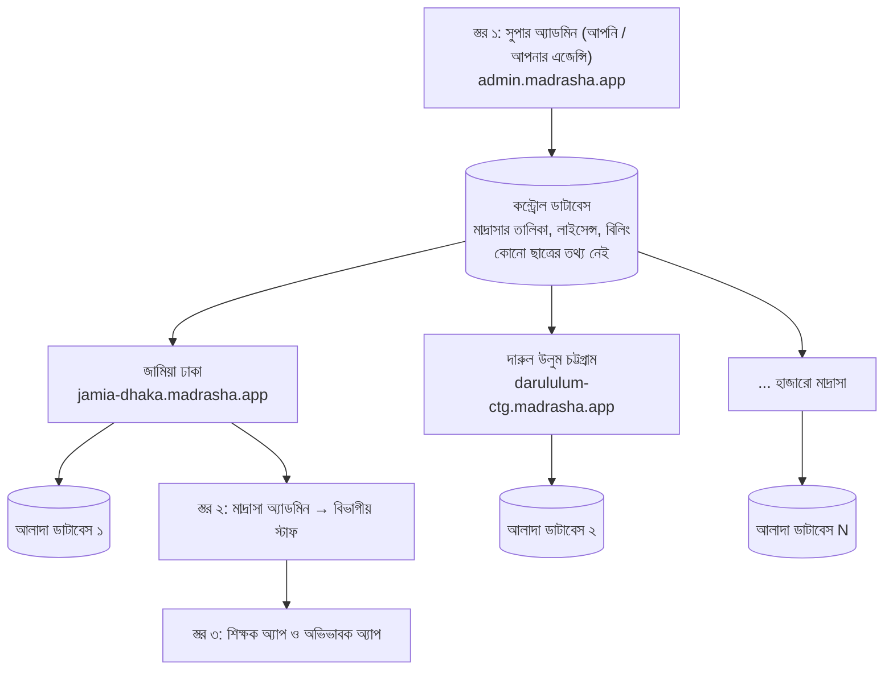
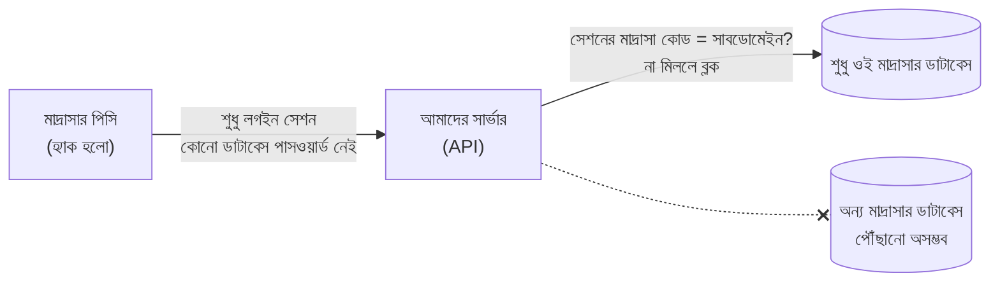
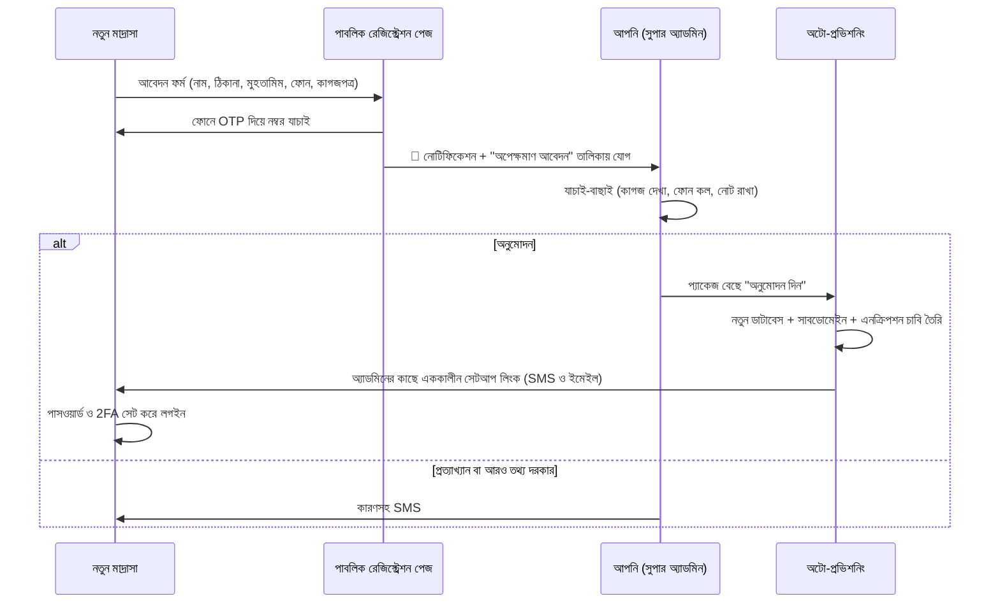
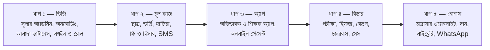

# জাতীয় মাদ্রাসা ম্যানেজমেন্ট প্ল্যাটফর্ম — ফিচার ও আর্কিটেকচার প্রস্তাবনা

> [!NOTE]
> এটি এখনো ইমপ্লিমেন্টেশন প্ল্যান নয়। এখানে আছে **কী কী থাকা উচিত এবং কেন**। আপনি এগুলো চূড়ান্ত করলে এর ভিত্তিতে বিস্তারিত প্ল্যান তৈরি হবে।

---

## ১. সামগ্রিক কাঠামো: তিন স্তর

- **স্তর ১ — সুপার অ্যাডমিন (আপনি):** মাদ্রাসা অনুমোদন, লাইসেন্স, বিলিং ও সাপোর্ট।
- **স্তর ২ — মাদ্রাসা অ্যাডমিন:** নিজ মাদ্রাসার পূর্ণ নিয়ন্ত্রণ এবং বিভাগ অনুযায়ী স্টাফদের অ্যাক্সেস ভাগ করে দেওয়া।
- **স্তর ৩ — শিক্ষক, অভিভাবক ও ছাত্র:** মোবাইল অ্যাপ ও পোর্টাল, প্রত্যেকে শুধু নিজের প্রয়োজনীয় তথ্য দেখবে।

---

## ২. প্রতিটি মাদ্রাসার ডাটা কীভাবে সম্পূর্ণ আলাদা ও নিরাপদ থাকবে

### ২.১ "আলাদা আইপি" নিয়ে একটি গুরুত্বপূর্ণ ব্যাখ্যা

প্রতিটি মাদ্রাসাকে আলাদা আইপি দেওয়ার দরকার নেই, এবং সেটা কার্যকরও নয়। কারণ:
- বাংলাদেশের অধিকাংশ ইন্টারনেট সংযোগে আইপি প্রতিদিন বদলায় (ডাইনামিক আইপি)।
- অভিভাবক ও শিক্ষকের মোবাইল অ্যাপ যেকোনো জায়গা থেকে চলবে, তাই আইপি দিয়ে বাঁধা যায় না।

**তার বদলে যা দেওয়া হবে:**

| আপনি যা চেয়েছেন | আমার প্রস্তাব |
|---|---|
| প্রতি মাদ্রাসার আলাদা অ্যাক্সেস বা ঠিকানা | **আলাদা সাবডোমেইন:** `jamia-dhaka.madrasha.app`। চাইলে তাদের নিজস্ব ডোমেইনও (`portal.jamiadhaka.com`) |
| আলাদা প্রোফাইল | কন্ট্রোল ডাটাবেসে প্রতিটি মাদ্রাসার **প্রোফাইল ও ইউনিক কোড** |
| সম্পূর্ণ আলাদা ডাটা | **প্রতিটি মাদ্রাসার আলাদা ডাটাবেস, আলাদা পাসওয়ার্ড এবং আলাদা এনক্রিপশন চাবি** |
| আইপি দিয়ে সুরক্ষা | **ঐচ্ছিক আইপি অ্যালাউলিস্ট**, শুধু হিসাব বা অ্যাডমিন প্যানেলের জন্য, যদি মাদ্রাসার স্ট্যাটিক আইপি থাকে |

### ২.২ ডাটাবেস আলাদা করার তিনটি পদ্ধতি

| পদ্ধতি | আলাদা থাকার মাত্রা | খরচ ও জটিলতা | মন্তব্য |
|---|---|---|---|
| ক. এক ডাটাবেস, প্রতিটি রো-তে `madrasa_id` (RLS দিয়ে) | মাঝারি | সবচেয়ে কম | একটি বাগ থাকলেই অন্য মাদ্রাসার ডাটা দেখা যেতে পারে |
| খ. এক ডাটাবেস, প্রতি মাদ্রাসার আলাদা স্কিমা | ভালো | মাঝারি | হাজারো স্কিমা হলে ব্যবস্থাপনা কঠিন |
| **গ. প্রতি মাদ্রাসার আলাদা ডাটাবেস + আলাদা ডাটাবেস ইউজার** ✅ | **সর্বোচ্চ** | বেশি, তবে অটোমেশনে সম্ভব | আপনার চাওয়া "একজনের ক্ষতি অন্যজনকে ছুঁতে পারবে না" — শুধু এটাই পুরোপুরি পূরণ করে |

**সুপারিশ: পদ্ধতি গ।**
- ডাটাবেস: PostgreSQL।
- প্রতিটি মাদ্রাসার জন্য আলাদা ডাটাবেস, আলাদা লগইন ইউজার এবং আলাদা ব্যাকআপ।
- এই ডাটাবেসগুলো এক বা একাধিক সার্ভারে রাখা হবে। মাদ্রাসা বাড়লে নতুন সার্ভার যোগ করা যাবে।
- বড় মাদ্রাসা চাইলে তাদের জন্য ডেডিকেটেড সার্ভার দেওয়া যাবে (প্রিমিয়াম প্যাকেজ)।

### ২.৩ মাদ্রাসার কম্পিউটার হ্যাক হলে কী হবে

1. **মাদ্রাসার পিসিতে কোনো ডাটাবেস পাসওয়ার্ড থাকবে না।** ব্রাউজারে থাকবে শুধু একটি স্বল্পমেয়াদি লগইন সেশন।
2. **প্রতিটি রিকোয়েস্টে সার্ভার দুটি জিনিস মিলিয়ে দেখবে:** সেশন কোন মাদ্রাসার, আর সাবডোমেইন কোন মাদ্রাসার। দুটো না মিললে রিকোয়েস্ট ব্লক হবে।
3. **ডাটাবেসগুলো ইন্টারনেটে খোলা থাকবে না।** শুধু আমাদের সার্ভার প্রাইভেট নেটওয়ার্কে ডাটাবেসের সাথে কথা বলবে।
4. **হ্যাক হলে ক্ষতি সীমিত থাকবে।** হ্যাকার সর্বোচ্চ ওই ইউজারের অনুমতি পর্যন্ত যেতে পারবে। তখন অ্যাডমিন এক ক্লিকে সব সেশন বাতিল করতে পারবেন।
5. **অ্যাডমিন ও হিসাব বিভাগের লগইনে 2FA বাধ্যতামূলক** (OTP বা Authenticator অ্যাপ)। পাসওয়ার্ড চুরি হলেও ঢোকা যাবে না।
6. **নতুন ডিভাইস থেকে লগইন হলে** অ্যাডমিনের কাছে নোটিফিকেশন যাবে। চাইলে অনুমোদন বাধ্যতামূলক করা যাবে।

---

## ৩. সুপার অ্যাডমিন প্যানেল (আপনার জন্য)

### ৩.১ নতুন মাদ্রাসার অনবোর্ডিং ফ্লো

### ৩.২ সুপার অ্যাডমিনের ফিচার

- **অপেক্ষমাণ আবেদন:** নোটিফিকেশন ব্যাজ, তালিকা, যাচাইয়ের নোট এবং অনুমোদন বা প্রত্যাখ্যানের বাটন।
- **মাদ্রাসা ডিরেক্টরি:**
  - নাম, জেলা ও উপজেলা, ধরন (কওমি, আলিয়া, হাফিজিয়া, নূরানী)
  - প্যাকেজ ও মেয়াদ, ছাত্রসংখ্যা, স্টোরেজ ব্যবহার
- **লাইসেন্স ও বিলিং:**
  - প্যাকেজ: ট্রায়াল, মাসিক, বার্ষিক
  - সাবস্ক্রিপশন ইনভয়েস, পেমেন্ট গ্রহণ
  - মেয়াদ শেষের রিমাইন্ডার
- **সাসপেন্ড বা আনলক:** সাসপেন্ডের আগে গ্রেস পিরিয়ড (যেমন ৭ দিন) থাকবে। সাসপেন্ড হলেও মাদ্রাসা নিজের ডাটা দেখতে ও এক্সপোর্ট করতে পারবে, শুধু নতুন এন্ট্রি বন্ধ থাকবে।
- **প্যাকেজভিত্তিক ফিচার নিয়ন্ত্রণ:** কোন প্যাকেজে কোন মডিউল চালু থাকবে (যেমন অভিভাবক অ্যাপ শুধু প্রিমিয়ামে)।
- **SMS ব্যালেন্স:** প্রতিটি মাদ্রাসার SMS ক্রেডিট বিক্রি ও রিচার্জ।
- **সাপোর্ট টিকিট** এবং **সব মাদ্রাসায় একসাথে ঘোষণা পাঠানো**।
- **নিরাপদ সাপোর্ট অ্যাক্সেস:**
  - আপনি বা আপনার স্টাফ মাদ্রাসার অনুমতি নিয়ে নির্দিষ্ট সময়ের জন্যই শুধু তাদের প্যানেলে ঢুকতে পারবেন।
  - প্রতিটি প্রবেশ মাদ্রাসার অডিট লগে দেখা যাবে।
  - এতে মাদ্রাসার আস্থা বাড়বে।
- **জাতীয় পরিসংখ্যান:** মোট মাদ্রাসা, মোট ছাত্র, জেলাভিত্তিক মানচিত্র। শুধু গাণিতিক সংখ্যা দেখা যাবে, কারো ব্যক্তিগত তথ্য নয়।
- **সিস্টেম মনিটরিং:** সার্ভারের অবস্থা, ব্যাকআপ সফল কিনা, এরর অ্যালার্ট।
- **আপনার এজেন্সির স্টাফ রোল:** মালিক, সাপোর্ট, সেলস/অনবোর্ডিং, বিলিং। প্রত্যেকের আলাদা অনুমতি থাকবে, আর সবার কাজ লগ হবে।

---

## ৪. মাদ্রাসার বিভাগ ও রোল (প্রস্তাবিত)

মাদ্রাসা অ্যাডমিন নিচের রোলগুলো ডিফল্ট হিসেবে পাবেন। প্রয়োজনে নিজে **নতুন রোল তৈরি** এবং **অনুমতি কাস্টমাইজ** করতে পারবেন।

| # | বিভাগ / রোল | প্রচলিত নাম | মূল দায়িত্ব |
|---|---|---|---|
| ১ | প্রধান অ্যাডমিন | মুহতামিম / প্রিন্সিপাল | সবকিছু, রোল তৈরি, বড় অনুমোদন |
| ২ | সহকারী অ্যাডমিন | নায়েবে মুহতামিম | মুহতামিমের দেওয়া অনুমতি অনুযায়ী |
| ৩ | শিক্ষা বিভাগ | নাজেমে তা'লিমাত | ক্লাস, রুটিন, শিক্ষক বণ্টন, পরীক্ষা |
| ৪ | দফতর / অফিস | দফতর | ভর্তি, ছাত্রের তথ্য, সনদ ও প্রত্যয়নপত্র |
| ৫ | হিসাব বিভাগ | মুহাসিব / হিসাবরক্ষক | লেজার, ব্যয়, বেতন, রিপোর্ট |
| ৬ | ক্যাশ কাউন্টার | খাজাঞ্চি / ক্যাশিয়ার | শুধু ফি গ্রহণ ও রসিদ, নিজের দিনের হিসাব |
| ৭ | অডিট বিভাগ | অডিটর / মজলিসে শূরা | **শুধু দেখা ও রিপোর্ট ডাউনলোড**, কোনো পরিবর্তন নয় |
| ৮ | ছাত্রাবাস | নাজেমে দারুল ইকামা | রুম বণ্টন, রাতের হাজিরা, ছুটির গেটপাস |
| ৯ | মেস / রান্নাঘর | মাতবাখ ব্যবস্থাপক | খাবারের তালিকা, বাজার, স্টক |
| ১০ | লাইব্রেরি | কুতুবখানা দায়িত্বশীল | কিতাব ইস্যু ও ফেরত |
| ১১ | পরীক্ষা বিভাগ | পরীক্ষা নিয়ন্ত্রক | সিট প্ল্যান, প্রবেশপত্র, নম্বর লক, ফলাফল প্রকাশ |
| ১২ | শিক্ষক | উস্তাদ | নিজের ক্লাস, হাজিরা নেওয়া, হিফজের সবক, নম্বর এন্ট্রি |
| ১৩ | দান ও তহবিল | বাইতুল মাল / কালেকশন | দাতা, দান, লিল্লাহ, যাকাত, চামড়া কালেকশন |
| ১৪ | গেট / নিরাপত্তা | দারোয়ান | গেটপাস স্ক্যান, ভিজিটর লগ |
| ১৫ | অভিভাবক | গার্জেন | **শুধু নিজের সন্তানের** তথ্য |
| ১৬ | ছাত্র (ঐচ্ছিক) | তালিবে ইলম | রুটিন, ফলাফল, নোটিশ |

### ৪.১ অনুমতির ম্যাট্রিক্স (উদাহরণ)

প্রতিটি মডিউলে ৬ ধরনের কাজের অনুমতি থাকবে: **দেখা, যোগ করা, সম্পাদনা, অনুমোদন, মুছা ও এক্সপোর্ট**।

| মডিউল ↓ / রোল → | মুহতামিম | হিসাবরক্ষক | ক্যাশিয়ার | অডিটর | শিক্ষক | অভিভাবক |
|---|---|---|---|---|---|---|
| ছাত্রের তথ্য | সব | দেখা | দেখা (সীমিত) | দেখা | নিজের ক্লাস | নিজের সন্তান |
| ফি আদায় | সব | সব | যোগ | দেখা | ✗ | নিজের ফি ও পেমেন্ট |
| আয়-ব্যয় লেজার | সব | যোগ ও সম্পাদনা | ✗ | দেখা ও এক্সপোর্ট | ✗ | ✗ |
| ছাড় / মওকুফ | অনুমোদন | প্রস্তাব | ✗ | দেখা | ✗ | ✗ |
| শিক্ষকের বেতন | সব | সব | ✗ | দেখা | শুধু নিজের স্লিপ | ✗ |
| হাজিরা | সব | ✗ | ✗ | দেখা | নিজের ক্লাস | নিজের সন্তান |
| পরীক্ষার নম্বর | অনুমোদন | ✗ | ✗ | দেখা | নিজের বিষয় | প্রকাশিত ফল |
| অডিট লগ | দেখা | ✗ | ✗ | দেখা | ✗ | ✗ |

**আরও কিছু সুরক্ষা নিয়ম:**
- **মেকার-চেকার নিয়ম:** একজন এন্ট্রি দেবে, অন্যজন অনুমোদন করবে। এটি প্রযোজ্য ছাড়, মওকুফ, বড় ব্যয়, বেতন পরিশোধ ও রিফান্ডে। এতে টাকা নয়ছয় ঠেকবে।
- **সংবেদনশীল তথ্য লুকানো:** যেমন শিক্ষকের বেতন বা অভিভাবকের ফোন নম্বর। অনুমতি না থাকলে দেখাবে `017*****89`।

---

## ৫. সম্পূর্ণ ফিচার তালিকা (মডিউলভিত্তিক)

চিহ্ন: ⭐ = প্রথম ভার্সনে (MVP) অবশ্যই থাকা উচিত · ➕ = পরের ধাপে

### ৫.১ ছাত্র ও ভর্তি
- ⭐ অনলাইন ও অফলাইনে ভর্তি আবেদন → যাচাই → **অনুমোদনের পরেই** রোল ও আইডি তৈরি।
- ⭐ ছাত্রের পূর্ণ প্রোফাইল: ছবি, জন্মনিবন্ধন, অভিভাবক, ঠিকানা, রক্তের গ্রুপ, স্বাস্থ্য তথ্য।
- ⭐ বিভাগ → জামাত/ক্লাস → শাখা কাঠামো (নূরানী, নাজেরা, হিফজ, কিতাব, জেনারেল)।
- ⭐ আইডি কার্ড ও QR প্রিন্ট।
- ⭐ বছর শেষে **পরবর্তী জামাতে প্রমোশন** (একসাথে সবার)।
- ⭐ এক্সেল থেকে পুরনো ছাত্রদের তথ্য একবারে আমদানি।
- ➕ ছাড়পত্র (TC), প্রত্যয়নপত্র ও চারিত্রিক সনদ অটো-জেনারেট (QR দিয়ে যাচাইযোগ্য)।
- ➕ শৃঙ্খলা বা আচরণ রেকর্ড এবং স্বাস্থ্য/মেডিকেল রেকর্ড।
- ➕ ফুযালা (প্রাক্তন ছাত্র) ডাটাবেস।

### ৫.২ হিফজ ও নাজেরা (মাদ্রাসার বিশেষ ফিচার)
- ⭐ দৈনিক **সবক, সাবকি ও মানজিল (আমুখতা)** এন্ট্রি। শিক্ষক অ্যাপ থেকে ১০ সেকেন্ডে।
- ⭐ পারা ও পৃষ্ঠার অগ্রগতির গ্রাফ। পৃষ্ঠার হিসাব আসবে প্রকৃত পৃষ্ঠা-তালিকা থেকে, অনুমানে নয়।
- ⭐ অভিভাবক অ্যাপে প্রতিদিনের সবক দেখা।
- ➕ তাজবিদ মূল্যায়ন, খতমের তারিখের পূর্বাভাস, খতম সনদ।

### ৫.৩ শিক্ষা ও রুটিন
- ⭐ শ্রেণি রুটিন, শিক্ষক-বিষয় বণ্টন, কিতাবের তালিকা।
- ⭐ শিক্ষকের নিজের রুটিন ও ক্লাসের সময় (শিক্ষক পোর্টাল ও অ্যাপে)।
- ⭐ **হিজরি ও ইংরেজি — দুই ক্যালেন্ডার**, ছুটির তালিকা (রমজান, ঈদ)।
- ➕ বাড়ির কাজ ও নোট, পাঠ পরিকল্পনা।

### ৫.৪ হাজিরা
- ⭐ ছাত্রের হাজিরা: শিক্ষক অ্যাপ থেকে ক্লাসে বসেই, অথবা QR বা বায়োমেট্রিক মেশিনে।
- ⭐ শিক্ষক ও স্টাফের হাজিরা: বায়োমেট্রিক মেশিন, অথবা অ্যাপে লোকেশন যাচাইসহ।
- ⭐ অনুপস্থিত ছাত্রের অভিভাবককে **অটো SMS বা অ্যাপ নোটিফিকেশন**।
- ⭐ লেট মার্কিং ও মাসিক হাজিরা রিপোর্ট।
- ➕ ছাত্রাবাসে **রাতের হাজিরা** ও **নামাজের জামাতে উপস্থিতি**।

### ৫.৫ ছাত্রাবাস, ছুটি ও গেটপাস (আবাসিক মাদ্রাসার জন্য খুব জরুরি)
- ⭐ রুম ও সিট বণ্টন, আবাসিক/অনাবাসিক, বোর্ডিংয়ে খায় কিনা।
- ⭐ **ছাত্রের ছুটির গেটপাস:**
  1. অভিভাবক অ্যাপ থেকে আবেদন করবেন, নাজেম অনুমোদন দেবেন।
  2. গেটে QR স্ক্যান হবে।
  3. "আপনার সন্তান মাদ্রাসা থেকে বের হয়েছে / ফিরেছে" — অভিভাবকের কাছে নোটিফিকেশন যাবে।
- ➕ ভিজিটর / মেহমান লগ।

### ৫.৬ পরীক্ষা ও ফলাফল
- ⭐ পরীক্ষা তৈরি, রুটিন, সিট প্ল্যান, প্রবেশপত্র।
- ⭐ শিক্ষক অ্যাপ বা পোর্টাল থেকে নম্বর এন্ট্রি। জমা দেওয়ার পর **লক** হবে, পরিবর্তন করতে অনুমোদন লাগবে।
- ⭐ কওমি গ্রেড (মুমতাজ, জায়্যিদ জিদ্দান, জায়্যিদ, মাকবুল, রাসিব) এবং জেনারেল GPA — **মাদ্রাসা নিজের নম্বর সীমা সেট করবে**।
- ⭐ মার্কশিট, টেবুলেশন শিট, মেধাতালিকা। প্রকাশের পর অভিভাবক অ্যাপে দেখা যাবে।
- ➕ বেফাক বা অন্যান্য বোর্ডের রেজিস্ট্রেশনের তথ্য এক্সপোর্ট।
- ➕ খাতায় ব্লাইন্ড QR কোডিং (নিরপেক্ষ মূল্যায়ন)।

### ৫.৭ হিসাব ও অর্থ (সবচেয়ে সংবেদনশীল)
- ⭐ **ফি কাঠামো সেটআপ:** ভর্তি ফি, মাসিক বেতন, বোর্ডিং, পরীক্ষা ফি, জরিমানা — বিভাগ ও জামাতভিত্তিক।
- ⭐ প্রতি মাসে **অটো ইনভয়েস তৈরি**।
- ⭐ **ছাড়, বৃত্তি ও মওকুফ** (মেকার-চেকার অনুমোদনসহ)। এতিম ও গরিব ছাত্রদের ফ্রি করার ব্যবস্থা।
- ⭐ ক্যাশ কাউন্টার: রোল বা QR স্ক্যান → বকেয়ার তালিকা → টাকা গ্রহণ → **ক্রমিক নম্বরের রসিদ** প্রিন্ট → অভিভাবককে SMS ও অ্যাপ নোটিফিকেশন।
- ⭐ **অনলাইন পেমেন্ট:** বিকাশ, নগদ, রকেট ও কার্ড (অভিভাবক অ্যাপ থেকে)। পরিশোধের সাথে সাথে স্ট্যাটাস 🟢 "পরিশোধিত"।
- ⭐ **ক্যাশিয়ারের দৈনিক ক্লোজিং:** সিস্টেমের হিসাব আর হাতের নগদ মেলানো, পার্থক্য থাকলে রেকর্ড।
- ⭐ **ডাবল-এন্ট্রি হিসাব পদ্ধতি** (আড়ালে চলবে; ব্যবহারকারী দেখবেন সহজ আয়-ব্যয়ের খাতা)।
- ⭐ **আলাদা তহবিল:**
  - সাধারণ তহবিল
  - লিল্লাহ বোর্ডিং
  - যাকাত
  - সদকা
  - নির্মাণ তহবিল
  - কুরবানির চামড়া
  - ওয়াকফ
  - প্রতিটির আলাদা ক্যাশ ও ব্যাংক হিসাব থাকবে, আর এক তহবিল থেকে অন্য তহবিলে টাকা সরাতে বিশেষ অনুমোদন লাগবে।
- ⭐ ডাইনামিক আয়-ব্যয়ের খাত। প্রতিটি খাত কোন তহবিলের, তা নির্দিষ্ট থাকবে।
- ⭐ বকেয়া তালিকা এবং **মাস শেষের আগে অটো তাগাদা SMS**।
- ⭐ রিপোর্ট: দৈনিক ক্যাশবুক, মাসিক আয়-ব্যয়, তহবিলভিত্তিক স্থিতি, ট্রায়াল ব্যালেন্স।
- ➕ ব্যাংক হিসাব মেলানো (রিকনসিলিয়েশন), বাজেট বনাম প্রকৃত খরচ।
- ➕ অগ্রিম পেমেন্ট, রিফান্ড (অনুমোদনসহ)।

### ৫.৮ দান ও তহবিল সংগ্রহ
- ⭐ দাতার তালিকা: আজীবন দাতা, মাসিক দাতা, এককালীন দাতা।
- ⭐ দানের রসিদ (SMS ও PDF)। দাতা চাইলে তার দান কোন তহবিলে গেল, তা দেখতে পারবেন।
- ➕ অনলাইন দান পেজ (মাদ্রাসার নিজস্ব ওয়েবসাইটে)।
- ➕ ক্যাম্পেইন, যেমন "মসজিদ নির্মাণ — লক্ষ্য ৳১০ লাখ, সংগৃহীত ৳৪ লাখ"।
- ➕ কুরবানির চামড়া কালেকশন ট্র্যাকিং।

### ৫.৯ শিক্ষক ও HR
- ⭐ ডিজিটাল সার্ভিস বুক: যোগ্যতা, যোগদান ও পদত্যাগের তারিখ, কাগজপত্র।
- ⭐ ছুটির আবেদন (অ্যাপ থেকে) → অনুমোদন → ছুটির ব্যালেন্স।
- ⭐ বেতন শিট: মূল বেতন, ভাতা, কর্তন, অগ্রিম। **বেতন স্লিপ শিক্ষকের অ্যাপে**।
- ➕ প্রভিডেন্ট ফান্ড, ইনক্রিমেন্ট, বোনাস (ঈদ বোনাস)।
- ➕ শিক্ষকের কর্মমূল্যায়ন (স্বচ্ছ মাপকাঠিতে)।

### ৫.১০ মেস, স্টোর ও সম্পদ
- ⭐ দৈনিক বাজার খরচ এন্ট্রি (হিসাবের সাথে স্বয়ংক্রিয়ভাবে যুক্ত)।
- ⭐ চাল, ডাল ও তেলের মজুত। কম হলে সতর্কতা দেখাবে (সর্বনিম্ন পরিমাণ মাদ্রাসা নিজে সেট করবে)।
- ➕ প্রতিদিন কতজন খাবে, তার হিসাব (ছুটিতে থাকা ছাত্র বাদ দিয়ে)।
- ➕ স্থায়ী সম্পদের তালিকা (আসবাব, কম্পিউটার, ফ্যান)।

### ৫.১১ লাইব্রেরি (কুতুবখানা)
- ➕ কিতাবের তালিকা (আরবি, বাংলা ও উর্দু নামে সার্চ), ইস্যু, ফেরত, জরিমানা।

### ৫.১২ যোগাযোগ ও নোটিশ
- ⭐ নোটিশ বোর্ড (পোর্টাল ও অ্যাপে)।
- ⭐ SMS — একজনকে, একটি জামাতকে বা সবাইকে। পাঠানোর আগে **খরচের হিসাব** দেখাবে।
- ⭐ অ্যাপ পুশ নোটিফিকেশন। এটি SMS-এর চেয়ে সস্তা, তাই অ্যাপ থাকলে আগে পুশ, না হলে SMS।
- ➕ WhatsApp মেসেজ।
- ➕ অভিভাবক-শিক্ষক বার্তা আদান-প্রদান (মাদ্রাসা চাইলে চালু বা বন্ধ করতে পারবে)।

### ৫.১৩ রিপোর্ট ও ড্যাশবোর্ড
- ⭐ মুহতামিমের ড্যাশবোর্ড: আজকের হাজিরা, আজকের আদায়, বকেয়া, তহবিলের স্থিতি।
- ⭐ "পিন টু ড্যাশবোর্ড" শর্টকাট।
- ⭐ সব রিপোর্ট PDF ও Excel-এ এক্সপোর্ট (বাংলা ফন্টসহ)।
- ⭐ অডিট লগ: কে, কখন, কোন কম্পিউটার থেকে, কী পরিবর্তন করেছেন — আগের ও পরের মানসহ।

### ৫.১৪ মাদ্রাসার নিজস্ব ওয়েবসাইট (বোনাস ফিচার)
- ➕ প্রতিটি মাদ্রাসার জন্য একটি **পাবলিক ওয়েবসাইট**:
  - পরিচিতি, নোটিশ, ভর্তি তথ্য
  - অনলাইন ভর্তি আবেদন
  - অনলাইন দান
  - ফলাফল দেখা
- ➕ একই প্ল্যাটফর্ম থেকে টেমপ্লেট বেছে নিলেই ওয়েবসাইট তৈরি হয়ে যাবে।

---

## ৬. মোবাইল অ্যাপ

### ৬.১ অভিভাবক অ্যাপ
| ফিচার | বর্ণনা |
|---|---|
| ⭐ একাধিক সন্তান | এক অ্যাকাউন্টে একাধিক সন্তান। প্রয়োজনে একাধিক মাদ্রাসায় পড়া সন্তানও। |
| ⭐ দৈনিক হাজিরা | সন্তান উপস্থিত না অনুপস্থিত, কখন এসেছে |
| ⭐ ফি ও পেমেন্ট | বকেয়া → বিকাশ, নগদ বা কার্ডে পরিশোধ → 🟢 পরিশোধিত → রসিদ ডাউনলোড |
| ⭐ পেমেন্টের নিশ্চিতকরণ | পুশ নোটিফিকেশন ও SMS |
| ⭐ হিফজ অগ্রগতি | প্রতিদিনের সবক, সাবকি ও মানজিল |
| ⭐ ফলাফল | প্রকাশিত মার্কশিট |
| ⭐ নোটিশ | মাদ্রাসার ঘোষণা, ছুটির খবর |
| ➕ ছুটির আবেদন ও গেটপাস | সন্তানকে বাড়ি নেওয়ার আবেদন, বের হওয়া ও ফেরার নোটিফিকেশন |
| ➕ দান | মাদ্রাসায় সরাসরি দান |

**লগইন পদ্ধতি:** অভিভাবকের ফোন নম্বর + OTP। ভর্তির সময় দেওয়া নম্বরের সাথে মিললে তবেই সন্তানের তথ্য দেখা যাবে।

### ৬.২ শিক্ষক অ্যাপ
- ⭐ নিজের রুটিন ও আজকের ক্লাস।
- ⭐ ক্লাসে ছাত্রদের হাজিরা নেওয়া (ইন্টারনেট না থাকলেও; পরে সিঙ্ক হবে)।
- ⭐ হিফজের সবক এন্ট্রি।
- ⭐ নম্বর এন্ট্রি।
- ⭐ নিজের হাজিরা, ছুটির আবেদন, বেতন স্লিপ।
- ⭐ নোটিশ।

**প্রযুক্তি:** দুটি অ্যাপই **Flutter** দিয়ে তৈরির সুপারিশ — একই কোডে Android ও iPhone। অন্তত প্রথম দিকে দুটি আলাদা অ্যাপ না বানিয়ে **রোলভিত্তিক একটি অ্যাপ**ও করা যায়।

---

## ৭. ডাটাবেস সিকিউরিটি — যা নিশ্চিত করা হবে

| স্তর | ব্যবস্থা |
|---|---|
| আলাদাকরণ | প্রতিটি মাদ্রাসার আলাদা ডাটাবেস ও আলাদা ডাটাবেস ইউজার; একটি মাদ্রাসার ইউজার অন্য ডাটাবেস খুলতেই পারবে না |
| নেটওয়ার্ক | ডাটাবেস প্রাইভেট নেটওয়ার্কে থাকবে, ইন্টারনেট থেকে সরাসরি পৌঁছানো অসম্ভব; সার্ভারে ফায়ারওয়াল |
| এনক্রিপশন | ডিস্কে এনক্রিপশন (AES-256), সব যোগাযোগ HTTPS/TLS-এ; NID, জন্মনিবন্ধন ও ফোন নম্বরের মতো সংবেদনশীল ফিল্ড আলাদাভাবে এনক্রিপ্টেড |
| চাবি ব্যবস্থাপনা | প্রতিটি মাদ্রাসার আলাদা এনক্রিপশন চাবি, যা সিক্রেট ম্যানেজারে থাকবে; কোডে বা `.env`-এ কোনো পাসওয়ার্ড নয় |
| ব্যাকআপ | প্রতিটি মাদ্রাসার আলাদা এনক্রিপ্টেড ব্যাকআপ; প্রতি মিনিটের লগ সংরক্ষণ (PITR), যাতে যেকোনো মুহূর্তে ফেরত যাওয়া যায়; ব্যাকআপের একটি কপি অন্য শহর বা অন্য প্রোভাইডারে; প্রতি মাসে রিস্টোর পরীক্ষা |
| অডিট লগ | শুধু যোগ করা যায়, মুছা বা এডিট করা যায় না; হ্যাশ-চেইনের কারণে কেউ গোপনে বদলালে ধরা পড়বে |
| লগইন | Argon2/bcrypt পাসওয়ার্ড হ্যাশ, অ্যাডমিন ও হিসাবের জন্য 2FA, ভুল পাসওয়ার্ডে সাময়িক লক, নিষ্ক্রিয় থাকলে অটো-লগআউট |
| অ্যাপ্লিকেশন | OWASP টপ-১০ সুরক্ষা, রেট লিমিট, ইনপুট যাচাই, XSS ও CSRF সুরক্ষা |
| মনিটরিং | সন্দেহজনক লগইন (নতুন দেশ বা ডিভাইস) এবং একসাথে বিপুল ডাটা ডাউনলোড হলে অ্যালার্ট |
| ডাটা মুছা | মাদ্রাসা সেবা বন্ধ করলে ডাটা এক্সপোর্ট করে দেওয়া, নির্দিষ্ট সময় পর নিরাপদে মুছে ফেলা |

---

## ৮. পেমেন্ট সিকিউরিটি — যা নিশ্চিত করা হবে

> [!IMPORTANT]
> **অভিভাবকের টাকা সরাসরি মাদ্রাসার নিজস্ব মার্চেন্ট অ্যাকাউন্টে যাবে, আপনার অ্যাকাউন্টে নয়।** অন্যের টাকা নিজের অ্যাকাউন্টে জমা নিয়ে পরে ভাগ করে দিলে বাংলাদেশ ব্যাংকের পেমেন্ট সিস্টেম নিয়ম অনুযায়ী আলাদা লাইসেন্স লাগতে পারে। এ বিষয়ে আইনজীবী বা পেমেন্ট গেটওয়ের সাথে নিশ্চিত হয়ে নিতে হবে। আপনার সাবস্ক্রিপশন ফি আলাদাভাবে আপনার অ্যাকাউন্টে আসবে।

| ঝুঁকি | ব্যবস্থা |
|---|---|
| ভুয়া "পেমেন্ট সফল" | অ্যাপের কথায় বিশ্বাস করা হবে না। **সার্ভার নিজে গেটওয়ের Validation API থেকে যাচাই** করবে, তারপরই 🟢 দেখাবে। |
| ভুয়া কলব্যাক | গেটওয়ের IPN বা কলব্যাকের **সিগনেচার যাচাই**। |
| একই পেমেন্ট দুবার জমা | প্রতিটি পেমেন্টে **ইউনিক আইডি (idempotency)**। একই ট্রানজেকশন আইডি দুবার গ্রহণ হবে না। |
| পরিমাণে কারসাজি | ইনভয়েসের টাকা আর গেটওয়ের টাকা হুবহু মিলতে হবে। |
| কার্ডের তথ্য চুরি | কার্ড নম্বর আমরা **কখনো সংরক্ষণ করব না**। গেটওয়ের নিজস্ব পেজে পেমেন্ট হবে। |
| হিসাবের গরমিল | প্রতিদিন রাতে গেটওয়ের রিপোর্টের সাথে **অটো রিকনসিলিয়েশন**। গরমিল থাকলে হিসাবরক্ষককে অ্যালার্ট। |
| ক্যাশ চুরি | ক্রমিক রসিদ নম্বর (মাঝে ফাঁক থাকলে ধরা পড়বে), ক্যাশিয়ারের দৈনিক ক্লোজিং, রসিদ বাতিল করতে অনুমোদন লাগবে। |
| এন্ট্রি মুছে ফেলা | আর্থিক এন্ট্রি কখনো মুছা বা এডিট করা যাবে না। ভুল হলে **রিভার্সাল এন্ট্রি**, যা অডিট লগে থাকবে। |
| মার্চেন্ট চাবি ফাঁস | প্রতিটি মাদ্রাসার গেটওয়ে চাবি এনক্রিপ্টেড অবস্থায় সিক্রেট ম্যানেজারে থাকবে। |

**সম্ভাব্য গেটওয়ে:** SSLCommerz, bKash PGW, Nagad, ShurjoPay, AamarPay। সবগুলোর সাথে কাজ করার জন্য একটি সাধারণ অ্যাডাপ্টার তৈরি হবে, যাতে মাদ্রাসা নিজের পছন্দের গেটওয়ে বেছে নিতে পারে।

---

## ৯. বাংলাদেশের প্রেক্ষাপটে আরও কিছু জরুরি বিষয়

- **ইন্টারনেট বা বিদ্যুৎ চলে গেলে:** ক্যাশ কাউন্টার ও শিক্ষক অ্যাপ সাময়িক অফলাইনে চলবে, পরে সিঙ্ক হবে। কনফ্লিক্ট সমাধানের নিয়ম আগেই ঠিক করা থাকবে।
- **ভাষা:** বাংলা (মূল), ইংরেজি এবং কিতাবের নামের জন্য আরবি ও উর্দু; বাংলা সংখ্যা; বাংলা ফন্টে PDF।
- **SMS খরচ:** বাংলায় এক SMS-এ ৭০ অক্ষর ধরে, তাই মেসেজ ছোট রাখা হবে। প্রতিটি মাদ্রাসার আলাদা ব্যালেন্স থাকবে, আর BTRC-র নিয়ম মেনে মাস্কিং করা হবে।
- **ব্যক্তিগত তথ্য সুরক্ষা:** ছাত্ররা অধিকাংশই অপ্রাপ্তবয়স্ক, তাই অভিভাবকের সম্মতি নেওয়া হবে এবং ন্যূনতম প্রয়োজনীয় তথ্যই রাখা হবে। বাংলাদেশের প্রযোজ্য ব্যক্তিগত তথ্য সুরক্ষা আইন বা অধ্যাদেশের বর্তমান অবস্থা যাচাই করে মেনে চলতে হবে।
- **সার্ভার কোথায় থাকবে:** দেশীয় ডাটা সেন্টার নাকি বিদেশি ক্লাউড (AWS বা Google Cloud-এর কাছের রিজিয়ন) — এটি খরচ, গতি ও আইনের ওপর নির্ভর করবে।
- **ধীর ইন্টারনেটেও দ্রুত:** গ্রামের মাদ্রাসার কথা মাথায় রেখে হালকা পেজ ও কম ডাটা ব্যবহার।
- **প্রশিক্ষণ:** ভিডিও টিউটোরিয়াল (বাংলায়) এবং অ্যাপের ভেতরে সাহায্য।

---

## ১০. প্রস্তাবিত ধাপভিত্তিক রোডম্যাপ (খসড়া)

---

## ১১. প্ল্যান ডিজাইনের আগে আপনার সিদ্ধান্ত দরকার

> [!IMPORTANT]
> 1. **বর্তমান কোড:** এই আর্কিটেকচারের জন্য (আলাদা ডাটাবেস, লগইন, অ্যাপ) বর্তমান Express + SQLite কোডের বড় অংশ নতুন করে লিখতে হবে। **নতুন করে শুরু করব** (সুপারিশকৃত; বর্তমান কোড থেকে UI ও লজিকের ধারণা নেওয়া হবে), নাকি বর্তমান কোডই ধাপে ধাপে বদলাব?
> 2. **প্রযুক্তি:** আমার প্রস্তাব — ব্যাকএন্ড NestJS + TypeScript, ডাটাবেস PostgreSQL, ওয়েব Next.js, মোবাইল Flutter। আপনার বা আপনার টিমের অন্য কোনো পছন্দ আছে?
> 3. **টার্গেট:** কওমি, আলিয়া, হাফিজিয়া, নূরানী — সবগুলো, নাকি প্রথমে শুধু কওমি ও হাফিজিয়া?
> 4. **সার্ভার:** দেশীয় ডাটা সেন্টার, নাকি বিদেশি ক্লাউড?
> 5. **পেমেন্ট:** প্রথমে কোন গেটওয়ে — বিকাশ, নাকি SSLCommerz (যেখানে সব একসাথে)?
> 6. **উপরের ফিচার তালিকা থেকে** কোনগুলো বাদ দেবেন, বা নতুন কী যোগ করতে চান?
> 7. **প্রথম ভার্সন (MVP):** ⭐ চিহ্নিত ফিচারগুলোই কি প্রথম ভার্সনের জন্য ঠিক আছে?
