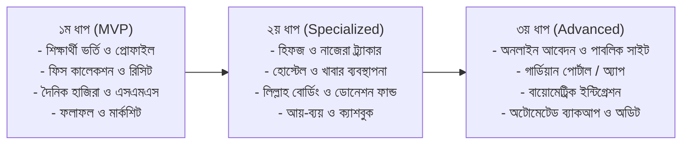

# সমন্বিত মাদ্রাসা ম্যানেজমেন্ট সফটওয়্যার: ফিচার ও ইউআই/ইউএক্স ব্লুপ্রিন্ট
*(Integrated Madrasa Management Software - Features & Design Specification)*

---

## ১. ভূমিকা ও উদ্দেশ্য (Overview)
একটি সমন্বিত মাদ্রাসা (নূরানী, হিফজ, কিতাব এবং আধুনিক সাধারণ শিক্ষা) পরিচালনার প্রক্রিয়া সাধারণ স্কুল বা কলেজের চেয়ে বেশ ভিন্ন। এখানে যেমন আধুনিক সাধারণ শিক্ষা (বাংলা, ইংরেজি, গণিত, বিজ্ঞান) ও সরকারি/বোর্ড পরীক্ষা থাকে, তেমনি ইসলামী দ্বীনি কারিকুলাম, হিফজের দৈনিক মূল্যায়ন (ছবক, সবকী, আমোখতা), আবাসিক হোস্টেল, মেস ও লিল্লাহ বোর্ডিং এবং যাকাত/সদকা ফান্ডের মতো বিশেষ খাত থাকে। 

এই সফটওয়্যারটির মূল লক্ষ্য হবে: **প্রশাসনিক জটিলতা দূর করা, হিসাব-নিকাশে শতভাগ স্বচ্ছতা আনা এবং শিক্ষক, শিক্ষার্থী ও অভিভাবকদের মধ্যে একটি নিরবচ্ছিন্ন ডিজিটাল সেতুবন্ধন তৈরি করা।**

---

## ২. কি কি ফিচার অ্যাড করা দরকার? (Core Features Breakdown)

### ক. শিক্ষার্থী ও ভর্তি ব্যবস্থাপনা (Student & Admission Management)
1. **অনলাইন ও অফলাইন ভর্তি:** 
   - সাধারণ ভর্তির আবেদন ফরম (অনলাইনে অভিভাবক পূরণ করতে পারবেন অথবা কাউন্টারে স্টাফ এন্ট্রি)।
   - পূর্ববর্তী মাদ্রাসার/স্কুলের ছাড়পত্র ও জন্মনিবন্ধন আপলোড।
2. **শিক্ষার্থী প্রোফাইল (Student 360° Profile):**
   - সাধারণ তথ্য, রক্তের গ্রুপ, জরুরি যোগাযোগ, অভিভাবকের বিবরণ।
   - বিভাগ নির্বাচন (নূরানী / নাজেরা / হিফজ / কিতাব / সাধারণ স্কুলিং)।
   - ক্যাটাগরি: আবাসিক (Residential), অনাবাসিক (Non-Residential), ডে-কেয়ার।
3. **স্মার্ট আইডি কার্ড জেনারেটর:**
   - এক ক্লিকে বারকোড / কিউআর কোডসহ লেমিনেটেড সাইজের আইডি কার্ড অটো-জেনারেট ও প্রিন্ট।
4. **রোল ও ক্লাস ম্যানেজমেন্ট:**
   - শিক্ষাবর্ষ অনুযায়ী অটো-রোল অ্যাসাইনমেন্ট, শাখা (Section), ব্যাচ ও শিফট নির্ধারণ।

---

### খ. হিফজ ও নাজেরা ট্র্যাকার (Hifz & Nazera Specialized Progress Tracker)
*মাদ্রাসার জন্য এটি অত্যন্ত গুরুত্বপূর্ণ ও বিশেষায়িত একটি মডিউল।*
1. **দৈনিক অগ্রগতি ট্র্যাকিং (Daily Routine Log):**
   - **সবক (New Lesson):** পারা নং, সূরা, আয়াত নম্বর বা পৃষ্ঠা নম্বর।
   - **সবকী (Recent Revision):** শেষ ৫-১০ পৃষ্ঠার অগ্রগতি ও ভুল-ত্রুটির সংখ্যা।
   - **আমোখতা (Dour / Old Revision):** আগের হিফজকৃত পারাসমূহের রিভিশন রেকর্ড।
2. **দৈনিক মূল্যায়ন ও গ্রেডিং:**
   - তাজবীদ, তালিবুল ইলমের মনোযোগ ও পাঠদানের মান (চমৎকার / ভালো / মধ্যম / পুনরাবৃত্তি দরকার)।
3. **হিফজ মাইলস্টোন ট্র্যাকার:**
   - একজন শিক্ষার্থী কত তম পারায় আছে এবং আনুমানিক কত দিনে হিফজ শেষ হতে পারে তার ভিজ্যুয়াল চার্ট।

---

### গ. অ্যাকাডেমিক ও পরীক্ষা ব্যবস্থাপনা (Academic, Exams & Combined Grading)
1. **দ্বৈত কারিকুলাম সমন্বয় (Dual Curriculum Grading):**
   - সাধারণ বিষয়সমূহ (বাংলা, ইংরেজি, গণিত ইত্যাদি) এবং দ্বীনি বিষয়সমূহ (কুরআন, হাদিস, ফিকহ, আরবি ব্যাকরণ/নাহু-সরফ)।
2. **মার্কশিট ও প্রগ্রেস রিপোর্ট কার্ড:**
   - গ্রেডিং সিস্টেম কনফিগারেশন (A+, A, B... অথবা মুমতাজ, জায়্যিদ জিদ্দান, জায়্যিদ, মাকবুল, রাসিব)।
   - এক ক্লিকে প্রিন্ট-রেডি পূর্ণাঙ্গ মার্কশিট জেনারেশন (প্রতিটি বিষয়ে প্রাপ্ত নম্বর, সর্বোচ্চ নম্বর, পজিশন ও শিক্ষকের মন্তব্যসহ)।
3. **পরীক্ষার শিডিউল ও সিট প্ল্যান:**
   - পরীক্ষার রুটিন প্রস্তুত এবং রোল নম্বরভিত্তিক স্বয়ংক্রিয় অ্যাডমিট কার্ড ও সিট প্ল্যান জেনারেট।

---

### ঘ. ডিজিটাল উপস্থিতি ও এসএমএস অটোমেশন (Attendance & Smart Alerts)
1. **উপস্থিতির পদ্ধতি:**
   - শিক্ষকদের মোবাইল/ট্যাবলেট দিয়ে ওয়ান-ক্লিক হাজিরা অথবা বায়োমেট্রিক/আরএফআইডি পাঞ্চ মেশিন ইন্টিগ্রেশন।
2. **স্বয়ংক্রিয় এসএমএস অ্যালার্ট (Bangla SMS):**
   - শিক্ষার্থী ক্লাসে অনুপস্থিত থাকলে সকাল ১০টার মধ্যে অভিভাবকের মোবাইলে সরাসরি বাংলায় বার্তা প্রেরণ।
   - হোস্টেল শিক্ষার্থীদের ক্ষেত্রে হোস্টেলে প্রবেশ ও বের হওয়ার সময় গার্ডিয়ান নোটিফিকেশন।
3. **শিক্ষক ও কর্মচারীদের হাজিরা:**
   - বায়োমেট্রিক/মোবাইল জিও-ফেন্সিং হাজিরা এবং লেট মার্কিং ও ছুটি ব্যবস্থাপনা।

---

### ঙ. ফিস কালেকশন ও হিসাবরক্ষণ (Fee Collection & Financial Accounting)
1. **স্বয়ংক্রিয় ফিস স্ট্রাকচার:**
   - মাসিক টিউশন ফি, হোস্টেল চার্জ, খাবার খরচ, বিদ্যুৎ বিল, পরীক্ষার ফি ইত্যাদি স্বয়ংক্রিয়ভাবে প্রতি মাসের ১ তারিখে জেনারেট হওয়া।
   - শিক্ষার্থীর অর্থনৈতিক অবস্থা অনুযায়ী বিশেষ ওয়েভার বা ডিসকাউন্ট (হাফ-ফ্রি / ফুল-ফ্রি) ব্যবস্থা।
2. **পেমেন্ট গেটওয়ে ও মোবাইল ব্যাংকিং:**
   - বিকাশ, নগদ, রকেট ইত্যাদির মাধ্যমে অভিভাবকদের সরাসরি পেমেন্ট সুবিধা।
   - পেমেন্ট সম্পন্ন হলে তাৎক্ষণিক মানি রিসিট এসএমএস ও প্রিন্টেবল পিডিএফ রিসিট।
3. **ক্যাশ কাউন্টার পেমেন্ট ও মানি রিসিট:**
   - কিস্তিতে পেমেন্ট, বকেয়া (Dues) ট্র্যাকিং এবং বকেয়া আদায়ের অটোমেটিক এসএমএস তাগাদা।
4. **অ্যাকাউন্টিং ও অডিট রিপোর্ট:**
   - দৈনিক আয়-ব্যয়ের হিসাব (Cash Book), ব্যাংক লেজার, প্রফিট-লস স্টেটমেন্ট এবং বাৎসরিক অডিট রিপোর্ট।

---

### চ. হোস্টেল, মেস ও লিল্লাহ বোর্ডিং (Hostel, Mess & Lillah Boarding)
1. **হোস্টেল ও রুম বরাদ্দ:**
   - বিল্ডিং, ফ্লোর, রুম এবং বেড নম্বর অনুযায়ী আবাসিক শিক্ষার্থীদের বরাদ্দ ও রেকর্ড।
2. **মেস ও খাবার ব্যবস্থাপনা (Meal Tracking):**
   - সকালের নাস্তা, দুপুর ও রাতের খাবার ট্র্যাকিং।
   - দৈনিক বাজার তালিকা ও খরচ ইনপুট এবং মিল রেট ক্যালকুলেশন।
3. **লিল্লাহ বোর্ডিং ও যাকাত/সদকা ফান্ড (Donation & Zakat Tracking):**
   - এতিম ও দুস্থ শিক্ষার্থীদের লিল্লাহ বোর্ডিং তহবিল থেকে সহায়তা ট্র্যাকিং।
   - মাদ্রাসার দাতা (Donors/Muawin) তালিকা, তাদের অনুদান সংগ্রহ, রসিদ প্রদান এবং বাৎসরিক দোয়ার আয়োজন/রিপোর্ট পাঠানো।

---

### ছ. শিক্ষক-কর্মচারী ও বেতন (HR & Payroll)
1. শিক্ষক ও স্টাফ প্রোফাইল, শিক্ষাগত যোগ্যতা ও নিয়োগ তথ্য।
2. মাসিক বেতন শিট তৈরি (বেসিক, বাসাভাড়া, বোনাস, প্রভিডেন্ট ফান্ড কর্তন ইত্যাদি)।
3. ছুটির আবেদন ও অনুমোদন প্রক্রিয়া (Leave Management)।

---

### জ. পাবলিক ওয়েবসাইট ও নোটিশ বোর্ড (Public Portal)
1. মাদ্রাসার ইতিহাস, মিশন, ভিশন ও পরিচিতি।
2. অনলাইন ভর্তি আবেদন ফরম ও ফলাফল চেক করার সুবিধা।
3. নোটিশ বোর্ড (পরীক্ষার রুটিন, বন্ধের ঘোষণা, মাহফিল/অনুষ্ঠানের নোটিশ)।

---

## ৩. ডিজাইন কেমন হওয়া উচিত? (UI/UX Design Guidelines)

মাদ্রাসা ম্যানেজমেন্ট সফটওয়্যারের ব্যবহারকারীরা (মুহতামিম, সিনিয়র শিক্ষক, ক্যাশিয়ার, অভিভাবক) সবার প্রযুক্তিগত দক্ষতা একই স্তরের নাও হতে পারে। তাই ডিজাইন হতে হবে **অত্যন্ত পরিচ্ছন্ন, দ্রুত লোড হওয়া এবং বিভ্রান্তিমুক্ত (Zero Clutter)**।

### ক. ইসলামিক ও আধুনিক এস্থেটিকস (Visual Identity & Color Palette)
- **Primary Color:** ডিপ এমারেল্ড গ্রিন (`#0D5C3A` বা `#0F766E`) — শান্তি, বিশ্বস্ততা ও ইসলামী ভাবগাম্ভীর্যের প্রতীক।
- **Secondary / Accent Color:** সফট গোল্ড / অ্যাম্বার (`#D97706` বা `#F59E0B`) — বাটন, ব্যাজ, হাইলাইটস ও অ্যালার্টের জন্য।
- **Background & Neutrals:** ওয়ার্ম অফ-হোয়াইট / স্লেট (`#F8FAFC`, `#F1F5F9`) — চোখে আরামদায়ক এবং সারাদিন কাজ করার উপযোগী।
- **Cards & Elements:** মডার্ন সফট শ্যাডো (Soft Shadows, Rounded Corners `rounded-xl`), কার্ডভিত্তিক বিন্যাস।

```
[ Primary: Emerald #0F766E ]   [ Accent: Gold #D97706 ]   [ Surface: White #FFFFFF ]   [ BG: Slate #F8FAFC ]
```

---

### খ. টাইপোগ্রাফি ও ভাষা সাপোর্ট (Typography & Multilingual UI)
1. **বাংলা ফন্ট:** `Hind Siliguri` অথবা `SolaimanLipi` — প্রশাসনিক রিপোর্টে স্পষ্ট এবং পাঠযোগ্য।
2. **ইংরেজি ও সংখ্যা:** `Inter` অথবা `Plus Jakarta Sans` — ফিস ও রিপোর্টের চার্ট ও সংখ্যার জন্য পরিষ্কার।
3. **আরবি ফন্ট:** `Amiri` অথবা `Scheherazade New` — হিফজ, হাদিস ও আরবি বিষয়গুলোর সঠিক নোকতা ও জের-জবর প্রদর্শনের জন্য।
4. **সহজ এক-ক্লিক ভাষা পরিবর্তন:** সফটওয়্যারের পুরো ইন্টারফেস বাংলা এবং ইংরেজিতে এক ক্লিকে টগল করা যাবে।

---

### গ. ড্যাশবোর্ড লেআউট স্ট্রাকচার (Layout Architecture)
1. **মুহতামিম/অ্যাডমিন ড্যাশবোর্ড (Muhtamim Executive View):**
   - উপরে ৪টি মূল KPI কার্ড:
     - মোট শিক্ষার্থী (উপস্থিত বনাম অনুপস্থিত)
     - আজকের ফিস কালেকশন বনাম মোট বকেয়া
     - আজকের মেস মিল কাউন্ট
     - নগদ ক্যাশ ইন হ্যান্ড
   - নিচে চার্ট: মাসিক আয়-ব্যয় ট্রেন্ড এবং হিফজ অগ্রগতি ওভারভিউ।
   - কুইক অ্যাকশন বাটন: "নতুন ভর্তি", "টাকা গ্রহণ", "জরুরি এসএমএস পাঠান", "হাজিরা নিন"।
2. **শিক্ষক প্যানেল (Teacher Portal - Mobile First):**
   - শিক্ষকদের জন্য ডেস্কটপের চেয়ে মোবাইলে ব্যবহার বেশি হবে।
   - এক ক্লিকে হাজিরা বাটন, ছবক-সবকী এন্ট্রি এবং পরীক্ষার মার্ক এন্ট্রি গ্রিড।
3. **ক্যাশিয়ার প্যানেল (Cashier / POS View):**
   - সুপার-ফাস্ট পেমেন্ট কালেকশন ইন্টারফেস (শুধু রোল/আইডি লিখলেই বকেয়ার তালিকা আসবে, অ্যামাউন্ট দিয়ে এন্টার চাপলেই রসিদ প্রিন্ট হবে)।

---

### ঘ. প্রিন্ট-রেডি ডিজাইন (Print-Ready Documents)
মাদ্রাসায় প্রতিদিন প্রচুর কাগজ প্রিন্ট করতে হয়। তাই প্রতিটি ডকুমেন্টের জন্য আলাদা CSS Print স্টাইল থাকতে হবে:
- **মানি রিসিট:** থার্মাল প্রিন্টার (POS 80mm/58mm) এবং A4/A5 পেপারে অটো-ফরম্যাট।
- **মার্কশিট ও সার্টিফিকেট:** অফিশিয়াল বর্ডার, মাদ্রাসার লোগো, ওয়াটারমার্ক এবং প্রিন্সিপাল/পরীক্ষা নিয়ন্ত্রকের স্বাক্ষরের স্থান।
- **এডমিট কার্ড ও আইডি কার্ড:** প্রতি পেজে ৩x৩ বা ৪x২ গ্রিডে স্বয়ংক্রিয় ফিট হওয়া।

---

## ৪. প্রস্তাবিত টেকনোলজি স্ট্যাক (Recommended Tech Stack)

| কম্পোনেন্ট | প্রযুক্তি | কেন এটি সেরা? |
| :--- | :--- | :--- |
| **Frontend** | React (Next.js) + Tailwind CSS | অতি দ্রুত গতি, আধুনিক প্রি-বিল্ট UI কম্পোনেন্ট, চমৎকার রেসপন্সিভনেস। |
| **Backend** | Node.js (Express) অথবা NestJS | রিয়েল-টাইম ডাটা হ্যান্ডলিং, স্কেলেবিলিটি এবং দ্রুত API ডেভেলপমেন্ট। |
| **Database** | PostgreSQL / MySQL | আর্থিক লেনদেন, হিসাবরক্ষণ ও শিক্ষার্থীদের জটিল সম্পর্কের জন্য নির্ভরযোগ্য রিলেশনাল ডাটাবেস। |
| **Authentication** | JWT + Role Based Access Control (RBAC) | প্রতিটি ইউজারের (অ্যাডমিন, শিক্ষক, ক্যাশিয়ার) আলাদা অনুমতি নিশ্চিতকরণ। |
| **SMS Gateway** | BD Bulk SMS API (ElitBuzz / Greenweb / Teletalk) | বাংলায় দ্রুত এসএমএস পৌঁছানো ও স্বল্প খরচ। |
| **Payment Gateway** | bKash Checkout / SSLCommerz / Shurjopay | দেশীয় সকল মোবাইল ব্যাংকিং ও কার্ড সাপোর্ট। |

---

## ৫. ধাপভিত্তিক বাস্তবায়ন রোডম্যাপ (Implementation Phases)



---
*এই ব্লুপ্রিন্ট অনুযায়ী কোডবেস এবং ইউআই ডেভেলপমেন্ট শুরু করা যেতে পারে।*
