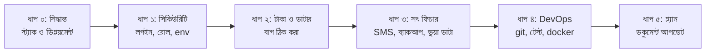

# মাদ্রাসা ম্যানেজমেন্ট সফটওয়্যার — সম্পূর্ণ প্রজেক্ট অডিট রিপোর্ট

**যা যা স্ক্যান করা হয়েছে:**
- ৩২টি ফিচার প্ল্যান, `INDEX-FEATURE-DIRECTORY.md` ও মাস্টার প্ল্যান
- সম্পূর্ণ ব্যাকএন্ড (`src/`)
- ফ্রন্টএন্ড (`public/`)
- Docker ও `.env` কনফিগ

কোনো কোড পরিবর্তন করা হয়নি।

> [!IMPORTANT]
> **সবচেয়ে বড় ৩টি সমস্যা:**
> 1. **প্ল্যান আর কোড দুটি সম্পূর্ণ আলাদা প্রোডাক্ট।** প্ল্যানে Next.js + PostgreSQL + Redis + TypeScript এবং একাধিক মাদ্রাসার জন্য SaaS। কিন্তু কোডে Express + সাধারণ JavaScript + SQLite, যা মূলত একটি মাদ্রাসার জন্য।
> 2. **কোনো লগইন বা সিকিউরিটি নেই।** সার্ভারে পৌঁছাতে পারলে যে কেউ ফি নিতে, বেতন বদলাতে, মাদ্রাসা সাসপেন্ড করতে বা ব্যাকআপ নিতে পারবে।
> 3. **কিছু ফিচার কাজ করে বলে দেখায়, আসলে করে না।**
>    - SMS আসলে যায় না।
>    - "এনক্রিপ্টেড ক্লাউড ব্যাকআপ" আসলে শুধু লোকাল ফাইল কপি।
>    - হাজিরা পেজ খুললে আসল ডাটাবেসে ভুয়া রেকর্ড ঢুকে যায়।

---

## পর্ব ক: প্ল্যান ডকুমেন্টের সমস্যা

### ক১. প্ল্যান বনাম কোডের অমিল (অতি গুরুতর)

| বিষয় | প্ল্যানে বলা আছে ([Master_Plan.md](file:///d:/SHARIF%20%204044/AI/projects/Madrasha%20Management%20Software/Project-Plan/Madrasa_Management_Software_Master_Plan.md#L171-L180)) | কোডে আসলে আছে |
|---|---|---|
| ফ্রন্টএন্ড | Next.js 14, Tailwind, Shadcn | একটি ১৬৬ KB `index.html` + সাধারণ JS + Tailwind **CDN** |
| ব্যাকএন্ড | NestJS/Express + **TypeScript** | Express 5 + সাধারণ JS |
| ডাটাবেস | **PostgreSQL + Prisma + RLS** মাল্টি-টেন্যান্ট | **SQLite** (পরীক্ষামূলক `node:sqlite`), একটি মাত্র ফাইল |
| কিউ | Redis + BullMQ | নেই |
| লাইসেন্সিং | JWT ক্রিপ্টো লাইসেন্স + হার্টবিট | শুধু `LIC-${Date.now()}-random` স্ট্রিং, কোনো যাচাই নেই |

ফিচার ফাইলগুলোও PostgreSQL ধরে লেখা (`gen_random_uuid()`, `pg_dump`, `.tsx`)। তাই সেগুলোর "বাগ ট্রাবলশুটিং" অংশ এই কোডে খাটে না।

### ক২. প্ল্যানের গুরুতর ডিজাইন ঘাটতি

**১. ডিপ্লয়মেন্ট মডেল পরস্পরবিরোধী — মূল ডাটাবেস কোথায় থাকবে, তা কোথাও বলা নেই।**
- SAAS-01: লোকাল ইনস্টল ও মেশিন আইডি।
- ACC-08: সেন্ট্রাল ক্লাউডে সিঙ্ক।
- ACA-07: লোকাল পিসিই মূল ডাটার উৎস।
- STU-01 ও TEA-03: অভিভাবক ও শিক্ষক মোবাইল থেকে ব্যবহার করবেন।
- SAAS-05: অথচ শুধু স্ট্যাটিক আইপি থেকে প্রবেশের অনুমতি।

**২. মাল্টি-টেন্যান্সির কোনো ডিজাইন নেই।**
- `tenant_id` কৌশল নেই।
- RLS, আলাদা স্কিমা না আলাদা ডাটাবেস — কোনোটাই ঠিক করা হয়নি।
- ওনার যেকোনো মাদ্রাসার ভেতরে ঢুকতে পারবেন, কিন্তু তার কোনো লগ বা সম্মতির ব্যবস্থা নেই।

**৩. "অপরিবর্তনীয়" অডিট লগ আসলে অপরিবর্তনীয় নয়।**
- শুধু সফট ডিলিট ও ট্রিগারের কথা বলা আছে।
- হ্যাশ-চেইন নেই, শুধু-যোগ-করা-যায় (append-only) এমন ব্যবস্থা নেই, বাইরে লগের কপিও নেই।
- আর্থিক এন্ট্রি এডিট করার ব্যবস্থা রাখা হয়েছে। সঠিক হিসাবরক্ষণে এডিট নয়, রিভার্সাল এন্ট্রি দিতে হয়।

**৪. অফলাইন ক্যাশ সিঙ্কে কনফ্লিক্ট সমাধানের কোনো নিয়ম নেই।**
- UUID শুধু ডুপ্লিকেট আইডি ঠেকায়; একই ইনভয়েস দুই কাউন্টারে আদায় হওয়া ঠেকায় না।
- অফলাইনে রসিদ নম্বর কীভাবে হবে, তা অনির্ধারিত।
- Background Sync শুধু Chrome-ভিত্তিক ব্রাউজারে চলে।

**৫. শরীয়াহ ফান্ড আলাদা রাখা আসলে শুধু রিপোর্টের একটি ফিল্টার** (`is_shariah_fund = false`)।
- POS-এ টাকা নেওয়ার সময় কোন ফান্ডে যাচ্ছে, তা বাছাইয়ের ব্যবস্থা নেই।
- ড্যাশবোর্ডে সব মিলিয়ে একটি "ক্যাশ ইন হ্যান্ড"।
- বোর্ডিং খাবারে যাকাত থেকে অটো-খরচের জন্য আলেমের ফতোয়া (তামলিক) দরকার।

**৬. রক্তের গ্রুপ দিয়ে অপ্রাপ্তবয়স্কদের অভিভাবকদের কাছে SMS পাঠানো গোপনীয়তার সমস্যা।**
- অধিকাংশ ছাত্রের বয়স ১৮-এর নিচে, যা রক্তদানের বয়সসীমার কম।
- নাম, রক্তের গ্রুপ, রুম নম্বর ও ফোন নম্বর সম্মতি ছাড়াই এক্সেলে ডাউনলোড হয়।

### ক৩. গুরুতর

- **লগইন সিস্টেমের কোনো বর্ণনা নেই।** পাসওয়ার্ড নীতি, OTP, সেশন, অভিভাবক বা শিক্ষক অ্যাকাউন্ট — কিছুই নেই।
- **রোল-ভিত্তিক অনুমতি (RBAC) খুব মোটা দাগের।**
  - শুধু "কোন পিসি কোন প্যানেল চালাবে" ঠিক করা যায়।
  - রোলের তালিকা নেই (মুহতামিম, হিসাবরক্ষক, ক্যাশিয়ার ইত্যাদি)।
  - ছাড় বা মওকুফে দ্বিতীয় ব্যক্তির অনুমোদন (maker-checker) নেই।
  - **ব্রাউজার MAC অ্যাড্রেস পড়তে পারে না**, তাই ওয়েব অ্যাপে MAC বাইন্ডিং অসম্ভব।
- **দুটি বায়োমেট্রিক ফিচারের প্রোটোকল সাংঘর্ষিক।**
  - TEA-02 বলে পোর্ট 4370 (ZKTeco pull SDK)।
  - ACA-04 বলে `/iclock/cdata` (ADMS push)।
  - কোথাও ডিভাইস অথেন্টিকেশন নেই।
- **ব্যাকআপের দাবি পরস্পরবিরোধী।**
  - একদিকে "জিরো ডাটা লস", অন্যদিকে দিনে মাত্র একবার ব্যাকআপ। অর্থাৎ ২৪ ঘণ্টা পর্যন্ত ডাটা হারাতে পারে।
  - `pg_dump` ইনক্রিমেন্টাল নয়, অথচ তাই বলা হয়েছে।
  - AES চাবি কার কাছে থাকবে, তা বলা নেই। ওনার সব মাদ্রাসার ডাটা পড়তে পারবেন।
- **QR সিকিউরিটি নিয়ে ভুল ধারণা।**
  - HMAC-কে "এনক্রিপশন" বলা হয়েছে।
  - টোকেন স্থায়ী — মেয়াদ নেই, কার্ড হারালে বাতিলের উপায় নেই।
  - যে কেউ কার্ড স্ক্যান করলে ছাত্রের তথ্য দেখতে পায়।
- **SMS-এর খরচ ও নিয়মকানুন উপেক্ষিত।**
  - বাংলা ইউনিকোডে এক SMS-এ মাত্র ৭০ অক্ষর, তাই প্ল্যানের উদাহরণ-মেসেজগুলো ২–৩টি SMS-এর সমান।
  - মাদ্রাসাভিত্তিক SMS ব্যালেন্স নেই।
  - BTRC মাস্কিং নিয়ম ও আনসাবস্ক্রাইব (opt-out) ব্যবস্থা নেই।
- **MPO-কে মাদ্রাসার আয় হিসেবে দেখানো হয়েছে।**
  - MPO শুধু আলিয়া মাদ্রাসার জন্য, আর সরকার সরাসরি শিক্ষকদের দেয়।
  - টার্গেট মার্কেট (কওমি, আলিয়া নাকি দুটোই) কোথাও বলা নেই।
- **২০ মিনিট পরপর হার্টবিটের কিল-সুইচ অফলাইনে কাজ করবে না।**
  - অফলাইনে কতদিন ছাড় (গ্রেস পিরিয়ড) থাকবে, তা নেই।
  - `package_type DEFAULT 'STANDARD'` অনুমোদিত তালিকায় নেই।

### ক৪. মাঝারি ও ছোট সমস্যা

- **গ্রেডিং স্কেল মেলে না।** STU-05 ও ACA-01-এ গ্রেডের নাম ভিন্ন, আর নম্বরের সীমা নির্ধারিত নেই।
- **কাঠামোর অমিল।** ড্যাশবোর্ডে ৬টি পিলার, কিন্তু মডিউল ফোল্ডার ৫টি।
- **হিজরি ক্যালেন্ডার নেই।** শিক্ষাবর্ষ, রমজানের ছুটি ও যাকাত বর্ষের জন্য এটি জরুরি।
- **হিফজের হিসাব ভুল।** "১ পারা = ২০ পৃষ্ঠা" সব পারার জন্য সঠিক নয়; একটি পৃষ্ঠা-তালিকা ব্যবহার করা উচিত।
- **ব্রাউজার থেকে সরাসরি থার্মাল প্রিন্ট বাস্তবসম্মত নয়।** প্রিন্ট এজেন্ট বা কিয়স্ক মোড লাগবে।
- **অনুমোদনের আগেই ভর্তির প্রভাব পড়ে।** ফর্ম জমা দিলেই আইডি, ইনভয়েস ও SMS তৈরি হয়ে যায়।
- **ফি সংক্রান্ত অনেক ফিচার নেই।**
  - ফি কাঠামো সেটআপ, জরিমানা, রিফান্ড ও অগ্রিম পেমেন্ট
  - বিকাশ/নগদ
  - বছর শেষে ক্লাস প্রমোশন
- **ডাটা মডেলের অভাব।** ৩২টির মধ্যে মাত্র ১টি ফাইলে স্কিমা আছে, কোনো ERD নেই।
- **"রিয়েল-টাইম" কীভাবে হবে, বলা নেই** (WebSocket, SSE নাকি পোলিং)।
- **টাইমজোনের নিয়ম অস্পষ্ট।**
- **অস্পষ্ট শর্তের কোনো মাপকাঠি নেই।** যেমন: "চোখের পলকে", "১-ক্লিক", "জিরো ডাটা লস", "শতভাগ শরীয়াহ সম্মত"।

### ক৫. যেসব অ-কার্যকরী চাহিদা (NFR) প্ল্যানে একদমই নেই

- সিকিউরিটি ও থ্রেট মডেল
- টেস্টিং কৌশল
- CI/CD, মনিটরিং ও আপডেট প্রক্রিয়া
- স্কেলিং লক্ষ্য
- বাংলা সংখ্যা, ফন্ট ও বাংলায় সার্চ
- এক্সেল বা কাগজ থেকে পুরনো ডাটা আনা
- আইনি দিক: ব্যক্তিগত তথ্য সুরক্ষা আইন, অপ্রাপ্তবয়স্কদের তথ্য, বায়োমেট্রিক ডাটা, BTRC
- প্রাইসিং ও সাবস্ক্রিপশন বিলিং

---

## পর্ব খ: কোডের সমস্যা

### খ১. অতি গুরুতর — সিকিউরিটি

| # | সমস্যা | প্রমাণ |
|---|---|---|
| ১ | **কোনো রাউটে লগইন বা অনুমতি যাচাই নেই।** কোনো auth মিডলওয়্যারই নেই। | [server.js](file:///d:/SHARIF%20%204044/AI/projects/Madrasha%20Management%20Software/src/server.js#L25-L29) — `src/`-এ `auth`/`jwt`/`bcrypt`/`password` খুঁজে ০টি পাওয়া গেছে |
| ২ | **`.env`-এ `JWT_SECRET`, `ADMIN_USER`, `ADMIN_PASS` আছে, কিন্তু কোথাও ব্যবহার হয় না।** `dotenv` ইনস্টল করা থাকলেও লোড করা হয় না। | `require('dotenv')` — ০টি |
| ৩ | **SaaS ওনারের অ্যাকশনগুলো সবার জন্য খোলা:** কিল-সুইচ, অনুমোদন, ব্ল্যাকলিস্ট, পারমিশন। | [saasAdminRoutes.js](file:///d:/SHARIF%20%204044/AI/projects/Madrasha%20Management%20Software/src/modules/01-central-saas-admin/routes/saasAdminRoutes.js) |
| ৪ | **বায়োমেট্রিক পুশ যাচাই ছাড়াই ডাটা নেয়।** যে কেউ `{student_id}` পাঠিয়ে যেকোনো ছাত্রকে "উপস্থিত" করতে পারে। ডিভাইস কী নেই, ডুপ্লিকেট চেকও নেই। | [biometricPushController.js:7-29](file:///d:/SHARIF%20%204044/AI/projects/Madrasha%20Management%20Software/src/modules/05-academic-iot/controllers/biometricPushController.js#L7-L29) |
| ৫ | **`cors()` সম্পূর্ণ খোলা।** রেট লিমিট, helmet ও ইনপুট ভ্যালিডেশন কোনোটাই নেই। | [server.js:17](file:///d:/SHARIF%20%204044/AI/projects/Madrasha%20Management%20Software/src/server.js#L17) |
| ৬ | **অডিট লগ বিশ্বাসযোগ্য নয়।** ইউজার ও কম্পিউটারের নাম হয় কোডে লেখা, নয়তো রিকোয়েস্ট থেকে আসে (`cashier_name`)। এটি সাধারণ টেবিল, তাই ডাটাবেসে ঢুকে যে কেউ বদলাতে পারে। | [feePosController.js:69](file:///d:/SHARIF%20%204044/AI/projects/Madrasha%20Management%20Software/src/modules/04-accounts-finance/controllers/feePosController.js#L69) |
| ৭ | **XSS ঝুঁকি।** ৭৯টি `innerHTML` ও ১২৫টি ইনলাইন `onclick=` ডাটাবেসের তথ্য (নাম ইত্যাদি) এস্কেপ না করেই দেখায়। | `public/js/modules/*.js`, `index.html` |

ভালো খবর: সব SQL কোয়েরিতে `?` প্লেসহোল্ডার ব্যবহার হয়েছে, তাই **SQL ইনজেকশন পাওয়া যায়নি**।

### খ২. অতি গুরুতর — টাকা ও ডাটার বাগ

| # | সমস্যা | প্রমাণ |
|---|---|---|
| ১ | **ফি আদায়ে কোনো ট্রানজেকশন নেই।** আগে ইনভয়েস আপডেট হয়। এরপর `student` না পেলে এরর হয়। ফলে ইনভয়েস "পরিশোধিত" হয়ে যায়, কিন্তু **রসিদ বা লেজার এন্ট্রি হয় না**। | [feePosController.js:41-67](file:///d:/SHARIF%20%204044/AI/projects/Madrasha%20Management%20Software/src/modules/04-accounts-finance/controllers/feePosController.js#L41-L67) |
| ২ | **টাকার পরিমাণ যাচাই হয় না।** ঋণাত্মক, `NaN` বা অতিরিক্ত টাকাও গ্রহণ করে। ইনভয়েসটি ওই ছাত্রেরই কিনা, তাও দেখে না। | একই ফাইল, L34-46 |
| ৩ | **রসিদ নম্বর মিলে যেতে পারে।** `REC-${Date.now().toString(36)}` — একই মিলিসেকেন্ডে দুটি পেমেন্ট হলে একই নম্বর পাবে। নম্বর ক্রমিকও নয়, অথচ হিসাবে ক্রমিক নম্বর দরকার। | L52 |
| ৪ | **শুধু দেখার (GET) রিকোয়েস্টে ভুয়া ডাটা লেখা হয়।** হাজিরা পেজ খুললেই আইডি ১, ২, ৪, ৬, ৭-এর জন্য ৫টি ভুয়া "উপস্থিত" রেকর্ড আসল ডাটাবেসে ঢোকে। | [biometricPushController.js:37-46](file:///d:/SHARIF%20%204044/AI/projects/Madrasha%20Management%20Software/src/modules/05-academic-iot/controllers/biometricPushController.js#L37-L46) |
| ৫ | **SMS আসলে পাঠানো হয় না।** শুধু লগে লেখা হয়, অথচ স্ক্রিনে দেখায় "SMS পৌঁছে গেছে"। অনুপস্থিতি SMS, বকেয়া তাগাদা ও POS রসিদ SMS — সবগুলোই এমন। | [biometricPushController.js:87-103](file:///d:/SHARIF%20%204044/AI/projects/Madrasha%20Management%20Software/src/modules/05-academic-iot/controllers/biometricPushController.js#L87-L103), [feePosController.js:71](file:///d:/SHARIF%20%204044/AI/projects/Madrasha%20Management%20Software/src/modules/04-accounts-finance/controllers/feePosController.js#L71) |
| ৬ | **ব্যাকআপ ভাঙা, আর মেসেজটি মিথ্যা।** WAL মোড চালু থাকা অবস্থায় শুধু `.sqlite` ফাইল কপি হয়; ৯৬০ KB-র `-wal` ফাইল **কপি হয় না**। ফলে ব্যাকআপ অসম্পূর্ণ বা নষ্ট হতে পারে। এনক্রিপশন নেই, ক্লাউডেও যায় না, অথচ মেসেজে লেখা "এনক্রিপ্টেড ক্লাউড ব্যাকআপ সম্পন্ন"। | [biometricPushController.js:133-154](file:///d:/SHARIF%20%204044/AI/projects/Madrasha%20Management%20Software/src/modules/05-academic-iot/controllers/biometricPushController.js#L133-L154) |
| ৭ | **মধ্যরাতের পর ভুল তারিখ সেভ হয়।** `new Date().toISOString().split('T')[0]` UTC তারিখ দেয়। তাই ঢাকার সময় রাত ১২টা থেকে সকাল ৬টার মধ্যে হাজিরা ও পেমেন্ট **আগের দিনের তারিখে** সেভ হয়। | অনেক কন্ট্রোলারে |
| ৮ | **সব ফি "মাসিক টিউশন ফি" খাতে যায়** (না পেলে `headId = 1`)। ফান্ড আলাদা হয় না, ফলে হোস্টেল ফি ও যাকাত মিশে যায়। | [feePosController.js:59-60](file:///d:/SHARIF%20%204044/AI/projects/Madrasha%20Management%20Software/src/modules/04-accounts-finance/controllers/feePosController.js#L59-L60) |
| ৯ | **বায়োমেট্রিকে একই দিনে একজনের অসীম ডুপ্লিকেট পাঞ্চ সেভ হয়।** হাজিরা টেবিলে `(student_id, date)` UNIQUE নেই। | L14-23 |

### খ৩. গুরুতর — আর্কিটেকচার

- **SaaS বলা হলেও বাস্তবে মাল্টি-টেন্যান্সি নেই।**
  - ২৫টি টেবিলের মধ্যে মাত্র ৪টিতে `madrasa_id` আছে, তাও সবসময় `DEFAULT 1`।
  - বিভাগ, ব্যাচ, ফি, লেজার ও পরীক্ষার টেবিলে `madrasa_id` নেই।
  - `student_code` ও `teacher_code` সব মাদ্রাসা মিলিয়ে UNIQUE।
  - মাদ্রাসার নাম কোডে লেখা ([server.js:90](file:///d:/SHARIF%20%204044/AI/projects/Madrasha%20Management%20Software/src/server.js#L90) ও SMS টেক্সটে)।
- **`node:sqlite` এখনও পরীক্ষামূলক।** এর জন্য Node ≥ 22.5 লাগে (আপনার v24 আছে ✓), কিন্তু `package.json`-এ `engines` দিয়ে তা বাধ্যতামূলক করা নেই।
- **ডাটাবেস ফাইল (WAL ও SHM সহ) `src/`-এর ভেতরে।**
  - `.gitignore` শুধু `data/` বাদ দেয়, তাই এগুলো বাদ পড়ে না।
  - `.dockerignore` নেই, ফলে **`.env` ও লাইভ ডাটাবেস Docker ইমেজে ঢুকে যায়**।
- **Dockerfile-এ পুরনো কমান্ড** `npm ci --only=production` (এখন `--omit=dev` ব্যবহার করতে হয়)। কন্টেইনার root ইউজার হিসেবে চলে।
- **স্ক্রিপ্ট ও টেস্টের অবস্থা।**
  - `dev` আর `start` একই।
  - টেস্ট বা লিন্ট স্ক্রিপ্ট নেই, **টেস্ট একটিও নেই**।
  - `morgan` ইনস্টল করা কিন্তু ব্যবহার হয় না।
- **Git রিপোজিটরি নেই।** কোনো ভার্সন কন্ট্রোল নেই।

### খ৪. মাঝারি — ফ্রন্টএন্ড

- **Tailwind CDN প্রোডাকশনের জন্য নয়।** `cdn.tailwindcss.com` ইন্টারনেট ছাড়া কাজ করে না; Google Fonts-ও তাই। এটি প্ল্যানের "অফলাইন-ফার্স্ট" দাবির বিরোধী।
- **১৬৬ KB-র একটি মাত্র `index.html`** রক্ষণাবেক্ষণ করা খুব কঠিন।
- **যেসব ব্যাকএন্ড এন্ডপয়েন্ট ফ্রন্টএন্ড থেকে কখনো কল হয় না:**
  - `/api/shortcuts*` — অর্থাৎ **"পিন টু ড্যাশবোর্ড" ফিচার যুক্তই করা হয়নি**
  - `kill-switch`
  - `verify-qr/:token`
  - `teachers/profile/:id`

### খ৫. ফিচার কভারেজ (প্ল্যান → কোড)

| মডিউল | অবস্থা |
|---|---|
| ০১ SaaS ও অ্যাডমিন | **আংশিক।** UI ও এন্ডপয়েন্ট আছে। লাইসেন্সিং, হার্টবিট ও লগইন নেই; অডিট লগ অপরিবর্তনীয় নয়; শর্টকাট যুক্ত নয়। |
| ০২ ছাত্র ও ভর্তি | **প্রায় সম্পূর্ণ।** ভর্তি, ব্যাচ ট্রি, সার্চ, হিফজ, QR যাচাই ও বৃত্তি আছে। আসল আইডি কার্ড, QR সিকিউরিটি ও অভিভাবকের অনলাইন ফর্ম নেই। |
| ০৩ শিক্ষক ও HR | **আংশিক।** সার্ভিস বুক, হাজিরা, ছুটি ও বেতন আছে। PF ও ইনক্রিমেন্টের হিসাব নেই, আসল বায়োমেট্রিকও নেই। |
| ০৪ হিসাব ও অর্থ | **আংশিক।** POS, বকেয়া, লেজার, খাত ও শরীয়াহ ভিউ আছে। **অফলাইন সিঙ্ক (ACC-08) নেই, আসল SMS নেই**, ফান্ড আলাদা হয় না। |
| ০৫ একাডেমিক ও IoT | **আংশিক।** পরীক্ষা, রুটিন, এডমিট কার্ড, নম্বর ও টেবুলেশন আছে। **ব্লাইন্ড QR গ্রেডিং, আসল IoT ও ক্লাউড ব্যাকআপ নেই।** |

---

## পর্ব গ: সমাধানের প্রস্তাবিত রোডম্যাপ (আপনার অনুমোদন প্রয়োজন)

**ধাপ ০ — সিদ্ধান্ত:** দুটি পথের একটি বাছাই করতে হবে।
- (ক) বর্তমান Express + SQLite রেখে প্ল্যানটি কোড অনুযায়ী লেখা, অথবা
- (খ) কোডকে প্ল্যানের স্ট্যাকে রূপান্তর করা।

**ধাপ ১ — সিকিউরিটি:**
- `dotenv` লোড করা।
- bcrypt + JWT দিয়ে লগইন এবং সব `/api` রাউটে মিডলওয়্যার।
- রোল টেবিল: সুপার অ্যাডমিন, মুহতামিম, হিসাবরক্ষক, ক্যাশিয়ার, শিক্ষক।
- বায়োমেট্রিক পুশের জন্য ডিভাইস API কী।
- `helmet`, সীমিত CORS ও রেট লিমিট।
- `innerHTML`-এর জন্য `escapeHtml` হেল্পার।

**ধাপ ২ — টাকা ও ডাটা:**
- `collectFee`, বেতন ও আয়-ব্যয়ের এন্ট্রি `BEGIN/COMMIT` ট্রানজেকশনে মোড়ানো।
- টাকার পরিমাণ যাচাই এবং ইনভয়েস-ছাত্র মিলিয়ে দেখা।
- ক্রমিক রসিদ নম্বর।
- Asia/Dhaka তারিখ হেল্পার।
- ভুয়া হাজিরার কোড মুছে ফেলা।
- হাজিরায় `(student_id, date)` UNIQUE।

**ধাপ ৩ — সৎ ফিচার:**
- আসল SMS গেটওয়ে অ্যাডাপ্টার (যেমন BulkSMSBD বা SSL Wireless)। গেটওয়ে কনফিগার না থাকলে ভুয়া সফলতার বদলে "কনফিগার করা হয়নি" দেখাবে।
- `VACUUM INTO` দিয়ে WAL-নিরাপদ ব্যাকআপ, ঐচ্ছিক AES এনক্রিপশন সহ।
- শর্টকাট হাব যুক্ত করা।

**ধাপ ৪ — DevOps:**
- `git init`।
- ডাটাবেস `data/` ফোল্ডারে সরানো (যা আগে থেকেই gitignore করা) এবং `.dockerignore` যোগ।
- `--omit=dev`, non-root ইউজার, `engines` ও `dev`-এর জন্য nodemon।
- `node:test` দিয়ে বেসিক API টেস্ট।

**ধাপ ৫ — প্ল্যান ডকুমেন্ট:**
- স্ট্যাক টেবিল ঠিক করা।
- টেন্যান্সি, লগইন, রোল, ফান্ড হিসাব ও ব্যাকআপের RPO/RTO নির্ধারণ।
- যেসব ফিচার এখনও তৈরি হয়নি, সেগুলোকে "পরিকল্পিত" হিসেবে চিহ্নিত করা।
- গ্রেডিং স্কেল এক করা।

## আপনার কাছে প্রশ্ন

> [!IMPORTANT]
> 1. **ধাপ ০:** বর্তমান Express + SQLite রাখব (দ্রুততম), নাকি প্ল্যানের Next.js + PostgreSQL-এ নতুন করে লিখব (বড় কাজ)?
> 2. **ডিপ্লয়মেন্ট:** প্রতিটি মাদ্রাসা নিজের লোকাল পিসি বা সার্ভারে চালাবে, নাকি সবাই একটি সেন্ট্রাল ক্লাউড সার্ভার ব্যবহার করবে?
> 3. **টার্গেট:** শুধু কওমি, শুধু আলিয়া, নাকি দুটোই? এটি MPO ও গ্রেডিংয়ের নিয়ম ঠিক করবে।
> 4. **কোন ধাপ থেকে শুরু করব?** আমার সুপারিশ: আগে ধাপ ১ ও ২।
